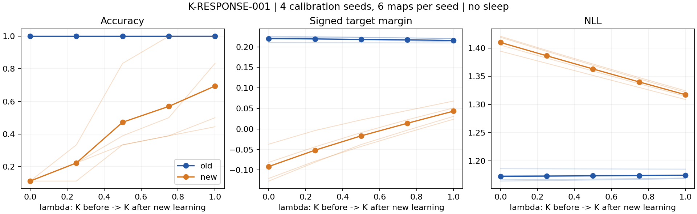

# Исправление стенда и K-RESPONSE-001

17 ноября 2026. Ветка `fix/sleep-need-sensitivity-001`, отдельный worktree.
База: `2291e34ad330427bce16f9b314dff6c43a5dc8f9`.

**Общий научный вердикт: PARTIAL.** Исправленные пути стенда прошли проверки;
ограниченный опыт завершён. Показано функциональное влияние обученного изменения
K на новые ответы при фиксированных B, W и начальном Z. Не установлены преимущество
вихря A, необходимость сна или существование полезной памяти в нуль-пространстве
readout. Полный протокол SLEEP-NEED пока не готов к подтверждающему запуску.

## Что исправлено

1. Запросы и anchor probes работают на глубоких копиях, сохраняют живые Z/K/B/W,
   RNG и конфигурацию. Вызов `reset_state=False` действительно читает из сохранённого Z;
   каждый запрос начинается из одной и той же копии исходного состояния.
2. Carry-state и проверка после 1000 idle ticks больше не сбрасывают исследуемый Z.
   NPZ сохраняет фактическое состояние конца сна, а не состояние после диагностики.
3. DREAM, REPLAY и SHAM внутри одной истории получают общий run_seed: одинаковые
   grounding events и шум. Журнал содержит идентификаторы истории, события и hashes.
4. Rollback сравнивает бит-в-бит все четыре логита по всем шести запросам до/после
   K_post → K_pre → K_post. Ранее сравнивались accuracy разных наборов запросов.
5. Padding доводит активные ticks до 1000 при любом разрешённом количестве слотов.
   Начальная/финальная диагностика учитывается отдельно: 96 ticks при шести anchors.
   При 25 слотах сон DREAM/REPLAY/SHAM требует 3496 core.step, IDLE — 1096.
   Это стоимость самой sleep session, не всей истории с обучением и оценкой задержки.
   IDLE по-прежнему не является контролем с равным полным вычислительным бюджетом.
6. Агрегируемый margin теперь signed target margin: логит верного класса минус
   максимальный логит конкурента. Для ошибочного ответа он отрицателен.
   Возвращаемый низкоуровневой query функцией top-two margin сохранён для совместимости;
   его смысл явно документирован. Старые журналы не перезаписывались.
7. Wake logs содержат логиты и hash обновления; snapshots дополнены K_initial,
   K_prefix, K_pre_sleep, Z_pre_sleep, конфигурацией, параметрами, RNG и ledger.
8. При отсутствии достаточной интерференции verdict контраста — TASK_NOT_INFORMATIVE.
   Положительный контраст без ещё не реализованных gates не называется доказательством
   необходимости DREAM. Запуск stage на M5 seeds 101–105 запрещён проверкой до записи файлов.

## Проведённый опыт

Протокол `K_RESPONSE_001_PROTOCOL.md` записан до запуска. Четыре ранее использованных
calibration seeds 11/12/13/42, шесть фиксированных mappings, всего 24 BLOCKED истории.
Обучение: 25+20 эпох старых событий и 20 эпох новых. Нет завершающего повторения
старых событий и нет сна. K0 сохранена перед новой группой, K1 — после неё.

Для λ=0,.25,.5,.75,1 измерены ответы при K(λ)=K0+λ(K1−K0), одинаковых B/W и Z0.
Это интервенция на носитель K; другие изменяемые состояния не переносятся в запрос.
Labels используются для обычного supervised wake update и последующей оценки,
но не передаются функции query. Проверяются выученные соответствия, а не перенос
на невиденные задачи или новые классы.

| Показатель | K0 | K1 | Изменение |
|---|---:|---:|---:|
| Accuracy старых ответов | 100% | 100% | 0 п.п. |
| Accuracy новых ответов | 11,11% | 69,44% | +58,33 п.п. |
| Signed margin старых | 0,220160 | 0,215491 | −0,004669 |
| Signed margin новых | −0,091291 | 0,043463 | +0,134754 |
| NLL старых | 1,173022 | 1,174911 | +0,001890 |
| NLL новых | 1,410038 | 1,317540 | −0,092498 |

Во всех 24 историях на всех пяти λ старые ответы остались правильными.
Для изменения старого margin описательный 95% t-интервал по четырём seed means:
[−0,010072; +0,000735]; для NLL: [−0,001653; +0,005433]. Оба включают ноль.
Нулевая дисперсия старой accuracy на этом маленьком фиксированном наборе не даёт
гарантии отсутствия забывания в генеральной совокупности. Это не новая независимая
репликация: использованы прежние calibration seeds и mappings.

**Интерпретация:** выученное ΔK влияет на поведение при чтении; результат нельзя
свести только к изменению числовой нормы K или сохранению последнего Z. При этом
старые ответы сохраняются, а средний сдвиг их непрерывных метрик мал и неоднороден.
Этот опыт подтверждает участок «изменение K → изменение прогноза» в данной задаче.
Он не проверяет начало цепочки «A → Z(t) → K» сравнением механизмов и не объясняет,
почему часть новых ответов остаётся неправильной.

## Локальная чувствительность

Центральная разность по направлению ΔK при ε=.01,.001,.0001 вычислена для реальной
восьмишаговой динамики. Максимальная норма расхождения оценок при .001 и .0001
по стеку 6×4 logits составила 5,286e−10. Это численная согласованность на выбранных
масштабах, не доказательство существования производной во всех точках системы.

Медианная относительная ошибка предсказания полного λ=1 отклика локальной производной
равна 2,33%, диапазон 0,62–19,53%. Следовательно, перенос локальной линейной аппроксимации
на целое обновление не всегда точен. Здесь не вычислялся полный Jacobian по 2304
параметрам K; нет SVD, параметрического проектора или вывода о nullspace.

## Проверяемость

- 34 теста прошли: исправленный sleep stand, математические инварианты и six-echelon core.
  Среди них инструментальный подсчёт вызовов, независимость probes, реальное carry-чтение,
  парность RNG и полный цикл одной истории с проверкой сохранённого Z.
- 4680 wake events, 1584 query records, 24 NPZ checkpoints.
- Все 48 hashes K до/после новой группы совпали с исходным пилотом бит-в-бит.
- Из файлов восстановлены 288 endpoint-запросов: все в допуске 1e−13, 241 бит-в-бит.
  Остальные отличаются из-за округления K0+(K1−K0) относительно прямого K1.
  Отдельная проверка прямого rollback K1→K0→K1 была битовой во всех 24 историях.
- Проверены 44 hashes сохранённого исходного кода/протокола; метрики пересчитаны из logits.
- Время основного опыта около 170 секунд на данном компьютере; оно не является benchmark.

Артефакты: `results/exploratory/K_RESPONSE_001/RUN_20261117/`.
В `source/` сохранена точная версия исходников на момент запуска. Последующие изменения
касаются metadata sleep snapshots, интеграционных тестов и защиты seeds; результаты
привязаны к сохранённому исходному коду и его hashes, а не только к имени текущей ветки.
`COMPLETE.json`, `artifact_verification.json`, `validation_sleep_sensitivity.xml`
содержат машинно проверяемый итог. Зависимость pynvml выдала deprecation warning;
ошибок выполнения и тестов не было.

## Ограничения и следующий шаг

Старый `run_sleep_need_pilot.py` всё ещё использует внешний абсолютный путь config;
в wake части ряд параметров жёстко задан. Positive joint control, prefix/retention gates
и ранний отказ от большого sleep stage ещё не реализованы. Общие случайные числа
обеспечены между sleep policies внутри истории, но не между BLOCKED/INTERLEAVED.
Полного нового sleep pilot не было; только регрессионные и интеграционные проверки.

Stage B остаётся закрытым. Следующий бриф — `ANTIGRAVITY_HANDOFF_RU.md`: довести эти
gates, затем провести малую калибровку интерференции без сна. Исследование nullspace
допустимо только после определения наблюдаемости по реальной динамике. Не менять
порог или нагрузку постфактум ради получения нужного результата.
