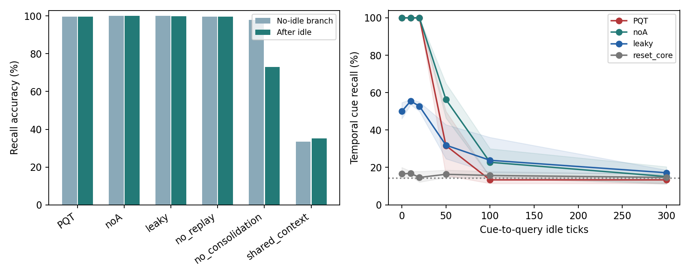
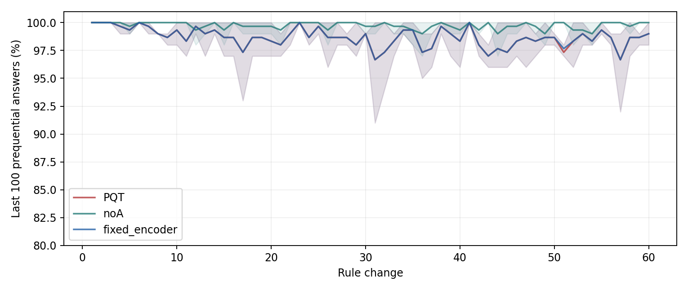
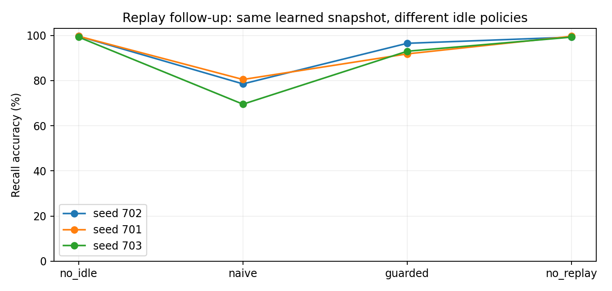

# PQT–QCat LIFE-001 — непрерывная пластичность и внутренняя активность

**Итог: PARTIAL.** Дата: 11 ноября 2026. Функциональный непрерывный прототип
работает; специфическое преимущество PQT и полноценная глубокая структурная
пластичность не доказаны. Это новая отдельная ветка `pqt-qcat-life-001`.
v0.1 сохранён неизменным; его завершённый аудит имеет вердикт PARTIAL.

## 1. Что действительно построено

Один объект Life сохраняет физическое состояние, обучаемые связи, быстрые и
медленные веса, опыт, pending eligibility, clock и RNG между обращениями.
predict выдаёт символ **до** feedback; feedback приходит спустя три события
и меняет связи без BPTT, offline optimizer или нового fit. Во время паузы
ядро продолжает ticks, консолидацию и повторное использование прошлого опыта.
Символы можно генерировать авторегрессивно, подавая предыдущий ответ как
следующий вход. Snapshot/resume сохраняет всю жизнь, включая отложенный feedback.

Это восемь символов и явные контексты, не языковое общение. Связь encoder
действительно меняется, но основной измеренный вклад в приобретённый опыт
вносит контекстный readout с быстрыми/медленными весами. Тест fixed_encoder
показывает, что малый текущий encoder-update не нужен для достигнутого качества.
Поэтому мы ещё не получили доказанную самостоятельную структурно-пластичную
PQT-систему, отличную по полезным свойствам от более простых online-механизмов.

## 2. Устройство и научные границы

Шесть восьмимерных PQT-ячеек,48 динамических координат, Heun с адаптивным
дроблением. r0_squared=.8; внешний tick=.01, одно событие 20 ticks.
Readout получает 97 признаков состояния и его реакции на вход; прямой
символ или правильный ответ в readout не передаются. На пять контекстов
создаются 7760 fast/slow коэффициентов плюс 234 обучаемых коэффициента encoder.
Физические W — координаты динамики; encoder/F/S — отдельные реальные связи.

Правило feedback: F += eta*(y−p)*eligibilityᵀ. Input update использует
локальный trace и фиксированный feedback projection; это **эвристика**,
не точный e-prop и не градиент всей рекуррентной системы. Консолидация
переносит часть F в S, мгновенно сохраняя F+S; F постепенно затухает.
Replay buffer ограничен 64 событиями на контекст, pending traces —256,
число выделяемых контекстов —32. Полная спецификация — ARCHITECTURE.md.

Внутренняя деятельность подпитывается явным replay forcing. Это не
непрерывный вечный цикл замкнутой диссипативной T=0 системы и не следствие
сохранения Gibbs-меры. Соответствующие различия установлены аудитом v0.1.
«Одновременно» здесь означает общую последовательность событий с обучением
между ответами, а не гонку параллельных потоков за общей матрицей.

Eligibility-подход мотивирован работой
[Bellec et al.,2020](https://pmc.ncbi.nlm.nih.gov/articles/PMC7367848/);
использованный локальный heuristic не воспроизводит её spiking-архитектуру.
Тест многих смен правил мотивирован
[Dohare et al.,2024](https://www.nature.com/articles/s41586-024-07711-7),
исследующей потерю способности учиться в других глубоких continual-системах.
DMN/replay используется только как функциональная аналогия с
[гипотезой cascaded memory systems](https://pmc.ncbi.nlm.nih.gov/articles/PMC12998549/).
Ни одна из этих работ не доказывает QCat или сознание программы.

## 3. Протокол и причинный порядок

Разработка: seeds11/12, learning_rate .3/.8/1.5 на 11; выбран.8, подтверждён
на 12. Затем отдельные основные seeds101–105, десять вариантов,50 жизней.
Каждая получает четыре неизвестные перестановки алфавита в явных контекстах
A/B/C/D по 500 событий, паузу 10000 ticks, новые вопросы, свободную генерацию,
новую версию A_v2 и отдельный конфликт новой версии под прежним именем A.
Полные правила известны только среде; agent получает labels через feedback.
Контексты задаются снаружи: автоматическое открытие контекстов не показано.

Оценка prequential: сначала предсказание, затем ошибка по будущему feedback.
Контрольные queries не получают target, но физические ticks и консолидация
не выключаются. Нет скрытого model.eval()/reset между этапами главной жизни.
Копии snapshot используются только в явно обозначенных парных диагностических
ветвях. Контроль reset_core специально нарушает сохранение физического состояния.

Каждая основная жизнь включает 94320 ticks и 4216 предсказаний; feedback3000.
Это ускоренное модельное время, не утверждение о работе всю ночь в реальном
времени. Отдельно реально запущенный JSONL-сервер подтвердил продвижение
clock в отсутствие сообщений, пока stdin открыт.

## 4. Главный опыт: обучение и сохранение опыта

± означает SD между пятью seed. Late — последние 100 предсказаний каждого
из первых четырёх правил; post-idle — среднее по четырём контекстам,64 query
на каждый. Δ idle сравнивает одинаковые query после паузы и в парной ветви
того же snapshot без паузы. Exact8 — полное совпадение восьми самостоятельно
сгенерированных символов,32 последовательности на seed.

| Вариант | Поздние ответы, % | После idle, % | Δ idle, п.п. | Exact8, % | Старое после нового, % |
| --- | --- | --- | --- | --- | --- |
| PQT | 99.90 ± 0.22 | 99.69 ± 0.33 | -0.08 | 94.38 ± 4.07 | 99.77 ± 0.35 |
| noA | 100.00 ± 0.00 | 100.00 ± 0.00 | +0.00 | 98.12 ± 1.71 | 99.77 ± 0.52 |
| leaky | 100.00 ± 0.00 | 99.92 ± 0.17 | -0.08 | 100.00 ± 0.00 | 100.00 ± 0.00 |
| frozen | 11.95 ± 2.20 | 11.09 ± 2.34 | +0.00 | 3.12 ± 2.21 | 11.56 ± 0.94 |
| no_replay | 99.90 ± 0.22 | 99.69 ± 0.17 | -0.08 | 93.75 ± 4.94 | 99.84 ± 0.35 |
| no_consolidation | 98.55 ± 0.82 | 73.05 ± 3.01 | -25.00 | 21.25 ± 17.73 | 71.95 ± 6.69 |
| reset_core | 99.45 ± 0.27 | 100.00 ± 0.00 | +0.47 | 100.00 ± 0.00 | 100.00 ± 0.00 |
| shared_context | 99.90 ± 0.14 | 35.08 ± 2.84 | +1.56 | 1.25 ± 1.71 | 7.66 ± 4.37 |
| fixed_encoder | 99.90 ± 0.22 | 99.69 ± 0.33 | -0.08 | 94.38 ± 4.07 | 99.77 ± 0.35 |
| no_replay_no_consolidation | 98.55 ± 0.82 | 97.81 ± 1.80 | -0.23 | 78.12 ± 11.48 | 97.19 ± 2.11 |

Полная PQT достигает среднего late=99.90 ± 0.22%,
после паузы —99.69 ± 0.33%,
свободная генерация —94.38 ± 4.07%.
Новый A_v2 усваивается с 100.00 ± 0.00%
на query; старые контексты остаются доступны. Медиана достижения 90%
в скользящем окне 100 событий на первых правилах —116 событий,
диапазон 103–170. Это обучаемость по многим примерам,
не one-shot понимание словесного правила.

Во время 10000 idle ticks во всех пяти полных жизнях: ноль новых внешних
событий и ноль новых teacher labels,500 replay updates,250 консолидаций.
Физические W при этом меняются: нормы смещения
1.084, 0.826, 0.904, 1.009, 0.922.
Encoder за жизнь изменяется на норму около 0.00114
при исходной норме порядка 8.5 — небольшой, измеримый эффект, функциональная
необходимость которого не показана. Context gates критичнее: shared_context
учит текущее правило, но теряет большую часть старых несовместимых правил.



Первая задача всё ещё допускает успешное решение статическим отображением
внутри каждого контекста. Поэтому результат reset_core в ней не считается
опровержением непрерывного runtime, но показывает, что этой задачи недостаточно
для доказательства использования физической рабочей памяти.

## 5. Проверка памяти между обращениями

Новый temporal assay: cue из 1..7, пауза, одинаковый для всех примеров query0.
Ответ зависит от раннего cue; текущий query и context сами по себе ответа
не содержат. Три новых seed301–303,1200 online trials на случайных gaps0..20;
затем 280 новых примеров на каждую задержку в парных продолжениях snapshot.
Во время проверки нет новых teacher labels. Таблица — проценты, SD по 3 seed.

| Вариант | Gap0 | Gap20 | Gap50 | Gap100 | Gap300 |
| --- | --- | --- | --- | --- | --- |
| PQT | 100.00 ± 0.00 | 100.00 ± 0.00 | 31.67 ± 17.27 | 13.33 ± 1.80 | 13.33 ± 1.80 |
| noA | 100.00 ± 0.00 | 100.00 ± 0.00 | 56.31 ± 9.34 | 22.74 ± 7.51 | 15.12 ± 4.66 |
| leaky | 50.00 ± 4.33 | 52.74 ± 2.53 | 31.90 ± 9.65 | 23.81 ± 10.63 | 17.14 ± 1.24 |
| reset_core | 16.55 ± 3.12 | 14.64 ± 2.92 | 16.31 ± 2.03 | 15.71 ± 1.89 | 14.64 ± 3.09 |

PQT и noA сохраняют рабочую информацию между вызовами и восстанавливают
cue на обученных промежутках. Reset_core возвращает результат к уровню
примерно 1/7. Простая leaky-замена с теми же интерфейсами и фиксированной
конфигурацией хуже на этом тесте; это не исчерпывающий подбор всех простых
RNN и не доказательство уникальности PQT. Уже noA показывает, что A не
обязателен. На gaps50–300 качество резко снижается: долговременное хранение
правила в связях и удержание текущего cue в динамике — разные свойства.
Долгая рабочая память пока не получена.

## 6. 60 смен правил без перезапуска

Отдельные seeds201–203, три варианта,60 меняющихся перестановок; три
повторно используемых контекста, по 300 событий и 100 idle ticks между
изменениями. В каждой жизни 366000 ticks,18000 предсказаний и feedback.
В таблице оцениваются последние 100 ответов каждого этапа, затем среднее
по первым/последним десяти этапам. Здесь требуется адаптация к новому
значению старого ID, а не одновременно сохранить все противоречивые версии.

| Вариант | Этапы 1–10, % | Этапы 51–60, % | max abs(z) в финале |
| --- | --- | --- | --- |
| PQT | 99.57 ± 0.21 | 98.40 ± 0.89 | 3.249 |
| noA | 99.97 ± 0.06 | 99.73 ± 0.06 | 1.824 |
| fixed_encoder | 99.57 ± 0.21 | 98.43 ± 0.91 | 3.249 |



Катастрофической потери способности учиться за 60 смен в этих опытах нет;
у PQT есть небольшое снижение качества в конце. Нельзя переносить это
на бесконечный поток, сложный язык или глубокую многослойную plasticity.
Практически совпадающий fixed_encoder подтверждает, что основной результат
обеспечен readout-пластичностью, а не доказанным обучением нового PQT-представления.

## 7. Контрпример: фоновая деятельность может вредить

В no_consolidation наивный replay дал среднее изменение качества около−25 п.п.
Отключение replay при той же отключённой консолидации гораздо безопаснее.
Это отрицательный результат, не удалённый из выборки. Само затухание всех
fast weights может долго сохранять argmax, одновременно снижая уверенность;
поэтому также сохранены cross entropy и confidence, а не только accuracy.

Дополнительная причинная диагностика на новых seeds601–603: одно online
обучение без консолидации, далее одинаковые query из ветвей одного snapshot.

| Политика idle без консолидации | Средняя точность, % |
| --- | --- |
| no_idle | 96.88 ± 3.05 |
| replay_on | 71.61 ± 10.45 |
| replay_off | 96.88 ± 3.05 |
| replay_without_drive | 71.61 ± 10.45 |
| consolidation_enabled | 86.98 ± 8.07 |
| freeze_core_during_idle | 71.61 ± 10.45 |

Вред остаётся при выключенном внутреннем forcing и при замороженном на
время idle core. В этих проверках источник — фоновое изменение readout,
а не одно лишь движение физического состояния. Интерпретация: replay по
сохранённым старым признакам может ухудшать ответы в текущем представлении.
Это согласованная с интервенциями гипотеза; все возможные причины не исчерпаны.

## 8. Защитный replay: отдельная проверка

После обнаружения дефекта добавлен **опциональный** guarded_replay, default
основного исследования остался False. Он периодически заново кодирует ранее
наблюдавшиеся context/token в shadow core и использует только уже полученные
labels. Proposed update отклоняется, если растёт BCE на этих anchors или
уменьшается число правильных anchors. Active physical state не откатывается.
Это защита на ограниченной прошлой выборке, не гарантия всех будущих ответов.

Тест заранее описан в guarded_replay_protocol.md; новые seeds701–703 не
использовались в разработке. Ни один final query target не доступен guard.
Сначала одинаковые snapshots без консолидации:

| Политика, новые seeds701–703 | После idle, % |
| --- | --- |
| no_idle | 99.48 ± 0.23 |
| naive | 76.17 ± 5.83 |
| guarded | 93.75 ± 2.44 |
| no_replay | 99.35 ± 0.23 |



Из 500 фоновых предложений guard отклонил
450, 475, 465 соответственно. Его дополнительные
shadow evaluations учтены в status.guard_anchor_evaluations; это реальная
вычислительная цена, не бесплатное улучшение.

В трёх отдельных полных жизнях с guard и обычной консолидацией post-idle
accuracy=100.00 ± 0.00%,
Exact8=87.50 ± 3.12%.
Эти три seed не объединяются с первичными пятью для увеличения эффектной
цифры. Режим остаётся экспериментальным: ограниченный anchor-набор не
может гарантировать отсутствие забывания вне своего покрытия.

В стресс-ветвях без консолидации guard уменьшил вред, но среднее ухудшение
относительно no-idle осталось около 5.73 п.п., то есть **не прошло** пилотный
допуск 5 п.п. Это не скрыто за улучшением относительно naive replay.

Поэтому отдельно проверен консервативный **state-only replay**: выбирается
прошлый опыт, продолжается внутреннее forcing и движение z, но replay не
переписывает readout. Обычный внешний feedback продолжает online-обучение,
консолидация сохраняется. Новые seeds801–803, прежние контрпримеры не удалены:

| Политика, новые seeds801–803 | После idle, % |
| --- | --- |
| no_idle | 99.74 ± 0.45 |
| naive | 75.91 ± 3.93 |
| state_only | 99.74 ± 0.45 |
| no_replay | 99.74 ± 0.45 |

Во всех трёх парных стресс-ветвях state-only сохранил точность no-idle,
при 500 внутренних replay events и нуле replay weight updates. Физическая
динамика при этом не была остановлена. В трёх новых полных жизнях с
консолидацией post-idle=100.00 ± 0.00%,
Exact8=91.67 ± 7.86%.
Это наблюдаемая сохранность в заданном опыте, не универсальная гарантия:
движение состояния всё ещё может нарушать рабочую память на длинных gaps.
Для интерактивного запуска предлагается явный флаг --state-only-replay;
основной исследовательский default оставлен неизменным для воспроизведения.

## 9. Численная и программная проверка

19 автоматических проверок: независимая конечная разность энергии,
малая закрытая диссипация, опасное состояние из аудита v0.1, persistent state,
причинный predict→feedback, изменение настоящих связей, bounded memory,
неповторяемый feedback, консолидация F+S, замороженный контроль, snapshot
с pending traces, guard rollback, guarded exact resume, autoregressive chain,
отказ при NaN logits и корректность входов/learning clock.

При 1000 одинаковых driven ticks RMS к reference8substeps:
k1: 6.64e-05, k2: 1.55e-05, k4: 3.07e-06, k8: 0.
Это наблюдаемая сходимость на фиксированном опыте, не глобальная гарантия.
Стресс 100000 idle ticks завершился без nonfinite. Во всех завершённых
primary/long/temporal жизнях шаги прошли finite checks. Если tolerance
дробления не достигается или logits нечисленны, система завершает шаг
ошибкой, не выдаёт фиктивный класс.

Реальный локальный сервер: фоновый clock продвинулся при открытом stdin
без входных сообщений; feedback после паузы принят, checkpoint записан,
процесс штатно завершён и восстановлен. Портов и сетевого сервиса нет.
Сервер не оставлен бесконечно расходовать ресурсы после проверки; запуск
для пользователя указан в README.md.

## 10. Короткий демонстратор

quick_demo.py запускает одну жизнь, учит переходы forward и reverse,
делает 10000 пустых ticks без новых labels, затем генерирует из символа 0:

```text
forward: [1, 2, 3, 4, 5, 6, 7, 0]
reverse: [7, 6, 5, 4, 3, 2, 1, 0]
```

Expected соответственно 1,2,3,4,5,6,7,0 и 7,6,5,4,3,2,1,0.
Это наглядная demonstration seed901, не часть статистики primary.
Её checkpoint лежит отдельно в runtime/demo_life.json.gz.

## 11. Вердикт и следующий научный вопрос

| Свойство | Итог |
|---|---|
| Одно сохраняющееся состояние и точный restart | PASS в выполненных тестах |
| Ответ до feedback, online-изменение связей, без offline fit | PASS |
| Усвоение новой символической функции и сохранение старой по явному context | PASS в основном опыте |
| Внутренняя активность без внешнего сообщения | PASS; источник — явный replay forcing |
| Безопасность любого фонового обучения | FAIL как универсальное утверждение; найден контрпример |
| Ограниченная защита replay на anchors | Проверена отдельно; не глобальная гарантия |
| Рабочая память между вызовами | PASS для коротких gaps0..20; FAIL для длинных gaps100..300 |
| Сохранение пластичности на 60 изменениях | PASS в ограниченном символическом стрессе |
| Необходимость A или преимущество полной PQT | Не подтверждены; noA часто лучше |
| Функционально необходимая глубокая/структурная plasticity ядра | Не установлена |
| Самостоятельное открытие контекстов, язык, сознание | Не исследованы/не заявляются |

LIFE-001 дал проверяемый переход от «обучили и выключили» к непрерывному
online runtime. Но следующий шаг не должен скрывать, что сохранение правил
пока в основном реализуют явные context gates и обычные fast/slow связи.
Научно содержательная LIFE-002: вывести eligibility через PQT-динамику,
показать полезное изменение представления; отделить защищённую рабочую
память от фонового replay; проверить новые ненаблюдаемые заранее контексты,
длинные задержки и другие генераторы. Сравнение с A=0 остаётся обязательным.

Артефакты: protocols, весь код, основной журнал predict/feedback каждого
seed, JSON/CSV, snapshots, тесты и графики. Отдельные ограничения:
небольшое число seed; синтетический конечный алфавит; explicit contexts;
неравные вычислительные расходы guarded replay; local input-update heuristic;
ограниченная память и потеря очень старого pending feedback. Отрицательные
результаты не заменены удачным demo.

Все символы основного теста уже встречались при обучении. Обобщение на
новые алфавиты, неизвестные композиции правил и естественный язык не
показано. Raw journals/snapshots хранятся рядом с кодом и включены в архив
поставки; в локальный Git включены код, отчёты и сводные данные.
